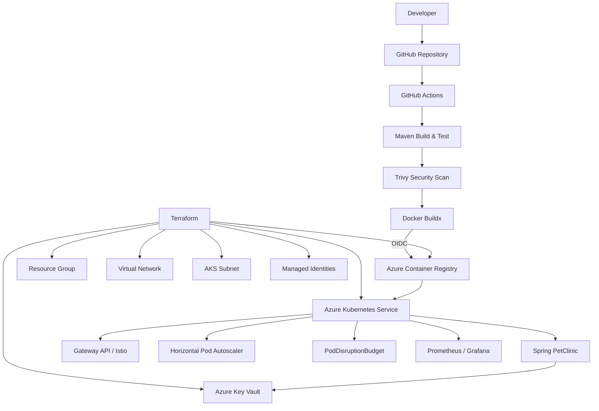

# Spring PetClinic Cloud Platform on Azure

A production-style cloud engineering project that provisions and operates a containerized Spring Boot application on **Microsoft Azure** using **Terraform, Azure Kubernetes Service, Azure Container Registry, Docker, GitHub Actions, Prometheus, Grafana, Helm, and Kubernetes**.

This repository focuses on the **application platform and Azure infrastructure layer**: provisioning cloud resources, building multi-architecture container images, deploying to AKS, configuring autoscaling and routing, integrating monitoring, and automating CI with GitHub Actions.

The GitOps continuous delivery layer is maintained separately in the companion GitOps repository.

---

## Architecture



---

## Project Goals

The goal of this project was to build a cloud environment that demonstrates practical experience across:

- Azure infrastructure provisioning
- Kubernetes operations
- Container build and registry workflows
- CI automation
- Application routing
- Autoscaling
- Monitoring and observability
- Cloud identity
- Secrets management
- Infrastructure troubleshooting
- Architecture trade-offs

Spring PetClinic is used as the application workload, while the main focus is the surrounding cloud platform.

---

## Azure Infrastructure

Azure infrastructure is provisioned using Terraform.

Core resources include:

- Azure Resource Group
- Azure Virtual Network
- AKS subnet
- Azure Kubernetes Service
- Azure Container Registry
- Azure Key Vault
- User-assigned managed identities
- Azure RBAC role assignments
- Federated identity credentials

Terraform provides a reproducible source of truth for the Azure environment.

---

## Infrastructure as Code

Terraform manages the Azure platform from:

```text
terraform/
└── azure/
```

The infrastructure includes:

```text
Resource Group
     ↓
Virtual Network
     ↓
AKS Subnet
     ↓
Azure Kubernetes Service
     ↓
Azure Container Registry
```

Additional security resources include:

```text
Azure Key Vault
     ↓
User-Assigned Managed Identity
     ↓
Federated Identity Credential
     ↓
Azure RBAC
```

---

## Azure Kubernetes Service

Spring PetClinic runs on Azure Kubernetes Service.

The Kubernetes deployment includes:

- Deployment
- Service
- Readiness probes
- Liveness probes
- Resource requests and limits
- Horizontal Pod Autoscaler
- PodDisruptionBudget
- Gateway API
- Istio application routing
- Prometheus ServiceMonitor
- Azure Key Vault CSI integration

---

## Containerization

The application is packaged as a Docker image.

A multi-stage Docker build separates the Maven build environment from the runtime image.

The final container runs with a JRE rather than the full development environment.

The container also runs as a non-root user.

---

## Multi-Architecture Container Builds

One of the major challenges in the project was a CPU architecture mismatch between the locally built Docker image and the AKS worker node.

The initial deployment failed with:

```text
exec format error
```

The application image was built for AMD64 while the AKS node required ARM64 compatibility.

The Docker configuration was redesigned to support multi-platform builds using Docker Buildx.

Supported architectures include:

```text
linux/amd64
linux/arm64
```

This allows the same CI process to build images compatible with different Kubernetes worker architectures.

---

## Continuous Integration

GitHub Actions handles the application CI workflow.

The pipeline performs:

```text
Checkout
   ↓
Maven Build
   ↓
Tests
   ↓
Docker Buildx
   ↓
Trivy Security Scan
   ↓
Push Image to Azure Container Registry
```

Images are tagged using the Git commit SHA rather than relying on `latest`.

Example:

```text
acrpetclinickydj7o.azurecr.io/petclinic:<git-sha>
```

This improves release traceability and allows exact application versions to be identified.

---

## Passwordless GitHub Authentication

GitHub Actions authenticates to Azure using **OpenID Connect**.

```text
GitHub Actions
      ↓
GitHub OIDC Token
      ↓
Microsoft Entra ID
      ↓
User-Assigned Managed Identity
      ↓
Azure Resources
```

No long-lived Azure client secret is required in GitHub Actions.

The CI identity is granted only the permissions needed to publish application images and interact with the required Azure resources.

---

## Azure Container Registry

Azure Container Registry stores application images produced by GitHub Actions.

The registry provides:

- Private image storage
- AKS integration
- Immutable SHA-based versions
- Multi-architecture images
- Controlled Azure RBAC access

AKS is configured with permission to pull images from ACR.

---

## Application Routing

The application uses the Kubernetes **Gateway API** together with Azure's Istio-based application routing capability.

The routing layer includes:

- GatewayClass
- Gateway
- HTTPRoute
- Kubernetes Service

The request flow is:

```text
External Request
      ↓
Azure Application Routing
      ↓
Istio Gateway
      ↓
Gateway API
      ↓
HTTPRoute
      ↓
PetClinic Service
      ↓
PetClinic Pod
```

---

## Autoscaling

The platform uses Kubernetes Horizontal Pod Autoscaling.

The HPA monitors CPU utilization and adjusts the number of application replicas within configured limits.

Example configuration:

```text
Minimum replicas: 2
Maximum replicas: 5
Target CPU: 60%
```

For the constrained Azure lab environment, replica counts were later adjusted to account for available node capacity.

---

## Availability Controls

A PodDisruptionBudget is used to control voluntary disruption of application replicas.

This helps demonstrate how Kubernetes availability requirements can be defined independently from the application Deployment.

---

## Monitoring and Observability

The monitoring platform uses `kube-prometheus-stack`.

Core components include:

- Prometheus
- Grafana
- Prometheus Operator
- node-exporter
- kube-state-metrics
- Alertmanager

Spring PetClinic exposes metrics using:

- Spring Boot Actuator
- Micrometer
- Prometheus registry

Application metrics are available through:

```text
/actuator/prometheus
```

Prometheus collects the metrics and Grafana is used to visualize application and Kubernetes behavior.

---

## Azure Key Vault

Application secrets are stored in Azure Key Vault.

The integration uses:

- Azure Key Vault
- Microsoft Entra Workload Identity
- User-assigned managed identity
- Federated identity credentials
- Azure RBAC
- Secrets Store CSI Driver

The application can access Key Vault without storing an Azure client password in Kubernetes or Git.

---

## Workload Identity

PetClinic uses a Kubernetes ServiceAccount linked to an Azure user-assigned identity.

```text
PetClinic Pod
      ↓
Kubernetes ServiceAccount
      ↓
AKS Workload Identity
      ↓
Federated Identity
      ↓
Azure RBAC
      ↓
Azure Key Vault
```

This provides passwordless authentication between the application workload and Azure.

---

## Key Engineering Challenges

### AKS Regional VM Availability

The original AKS configuration used a VM size that was unavailable in the selected Azure region.

The deployment had to be adapted based on the VM sizes available in Canada Central.

This demonstrated the importance of designing infrastructure around regional cloud constraints rather than assuming every SKU is available everywhere.

---

### Azure vCPU Quota

The subscription later reached its regional vCPU quota.

This prevented the AKS node pool from being expanded.

Rather than adding more compute, the environment was optimized around the available capacity.

Adjustments included:

- Reducing application replicas
- Reducing monitoring components
- Reducing Argo CD footprint
- Changing rollout strategy
- Tracking pod density

---

### Kubernetes Pod Density

The single AKS node supported a maximum of 30 pods.

As additional platform components were installed, the cluster reached:

```text
30 / 30 pods
```

This created real scheduling constraints.

The environment was adapted by identifying optional workloads and reducing their replicas while retaining core application functionality.

---

### Rolling Update Capacity

The original Deployment used:

```yaml
maxUnavailable: 0
maxSurge: 1
```

This required one extra pod during deployment.

At maximum node capacity, Kubernetes could not schedule that additional pod.

The rollout strategy was changed to:

```yaml
maxUnavailable: 1
maxSurge: 0
```

This allows Kubernetes to remove the old pod before creating the replacement.

This is documented as a lab-specific trade-off rather than the preferred production configuration.

---

### ACR Authentication

AKS initially failed to authenticate correctly with Azure Container Registry.

Azure RBAC and ACR role assignments were corrected so the cluster could retrieve application images.

---

### ARM64 Image Compatibility

The application initially entered `CrashLoopBackOff` because the container image architecture did not match the AKS node architecture.

The image pipeline was redesigned for ARM64 and later multi-architecture support.

---

### Azure Provider Registration

Several Azure services required resource providers to be registered before Terraform could provision resources.

Examples included:

```text
Microsoft.ContainerRegistry
Microsoft.ContainerService
Microsoft.KeyVault
```

Provider registration issues were diagnosed and resolved before continuing infrastructure provisioning.

---

### Git Bash Path Conversion

Because the development environment used Windows Git Bash, Linux-style arguments were occasionally rewritten into Windows paths.

For commands that needed literal Linux paths, the environment variable:

```bash
MSYS_NO_PATHCONV=1
```

was used to prevent path conversion.

---

## Repository Structure

```text
spring-petclinic-cloud-platform/
│
├── .github/
│   └── workflows/
│       ├── maven-build.yml
│       └── azure-cicd.yml
│
├── terraform/
│   └── azure/
│       ├── aks.tf
│       ├── acr.tf
│       ├── network.tf
│       ├── keyvault.tf
│       ├── variables.tf
│       ├── outputs.tf
│       └── providers.tf
│
├── kubernetes/
│
├── Dockerfile
├── pom.xml
├── src/
│
└── README.md
```

---

## Technology Stack

| Area | Technology |
|---|---|
| Cloud | Microsoft Azure |
| Infrastructure as Code | Terraform |
| Kubernetes | Azure Kubernetes Service |
| Registry | Azure Container Registry |
| Containers | Docker / Docker Buildx |
| CI | GitHub Actions |
| Build | Maven |
| Application | Java / Spring Boot |
| Routing | Gateway API / Istio |
| Monitoring | Prometheus / Grafana |
| Metrics | Spring Boot Actuator / Micrometer |
| Secrets | Azure Key Vault |
| Authentication | OIDC / Workload Identity |
| Authorization | Azure RBAC |
| Security Scanning | Trivy |
| Kubernetes Packaging | Helm |

---

## Related GitOps Project

Continuous delivery and Kubernetes desired state are maintained separately in:

**Spring PetClinic GitOps Platform**

https://github.com/Techy-T/spring-petclinic-gitops

That repository adds:

- Argo CD
- Helm-based GitOps
- Automated reconciliation
- Self-healing
- Dev → Staging → Production promotion
- Git-driven Kubernetes state
- GitOps-based secrets and monitoring configuration

The separation demonstrates a clear architectural boundary between:

```text
Application + Infrastructure
```

and:

```text
Kubernetes Desired State + Continuous Delivery
```

---

## Project Outcome

The completed project provides a cloud platform spanning:

```text
Terraform
   ↓
Azure Infrastructure
   ↓
AKS + ACR
   ↓
GitHub Actions
   ↓
Multi-Architecture Containers
   ↓
Kubernetes Deployment
   ↓
Gateway Routing
   ↓
Autoscaling
   ↓
Prometheus / Grafana
   ↓
Azure Key Vault
```

The project demonstrates practical experience across **Azure, Kubernetes, Terraform, Docker, GitHub Actions, networking, observability, cloud security, identity, troubleshooting, and cloud architecture**.

---

## Status

**Completed ✅**

This repository represents the Azure infrastructure, CI, and Kubernetes platform layer.

The companion GitOps repository builds on this foundation with Argo CD, Helm, immutable environment promotion, self-healing, and Git-driven continuous delivery.